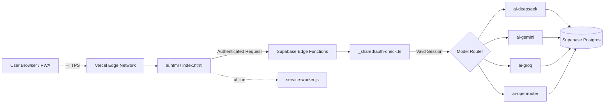

<div align="center">


# Zunexa

### AI-Powered Content Generation for the MENA & Moroccan Market

*Multi-model AI chat & content engine — DeepSeek · Gemini · Groq · OpenRouter — built with a privacy-first Supabase backend and a native-feeling PWA.*

[](https://zunexa.vercel.app/ai)
[](./LICENSE)
[](./manifest.json)
[](https://supabase.com)
[](https://vercel.com)

[Live Demo](https://zunexa.vercel.app/ai) · [Report Bug](mailto:mrahmed20101119@gmail.com) · [Request Feature](mailto:mrahmed20101119@gmail.com) · [Instagram](https://instagram.com/zunexa_ai)

</div>

---

## 📖 Table of Contents

- [About Zunexa](#-about-zunexa)
- [Features](#-features)
- [Tech Stack](#-tech-stack)
- [Architecture](#-architecture)
- [Project Structure](#-project-structure)
- [Getting Started](#-getting-started)
- [Environment & Secrets](#-environment--secrets)
- [Supabase Setup](#-supabase-setup)
- [Deployment (Vercel)](#-deployment-vercel)
- [PWA & Offline Support](#-pwa--offline-support)
- [Security](#-security)
- [Roadmap](#-roadmap)
- [Support](#-support)
- [License](#-license)

---

## ✨ About Zunexa

**Zunexa** is an AI-powered SaaS platform purpose-built for the **MENA and Moroccan markets**, delivering multi-model AI conversation and content generation through a sleek, RTL-native, Arabic-first interface — wrapped in a premium **"Zalij Mode"** noir-and-gold visual identity inspired by traditional Moroccan geometric art.

Unlike single-model wrappers, Zunexa routes requests across **multiple AI providers** (DeepSeek, Gemini, Groq, OpenRouter) through serverless Supabase Edge Functions, giving users flexibility across cost, speed, and capability tiers — all protected behind authenticated, rate-limited endpoints.

🔗 **Live app:** [zunexa.vercel.app/ai](https://zunexa.vercel.app/ai)

---

## 🚀 Features

- 🤖 **Multi-Model AI Engine** — Seamlessly switch between DeepSeek, Gemini, Groq, and OpenRouter models based on task complexity and effort level.
- 🌍 **RTL / Arabic-First UI** — Fully right-to-left interface with native Modern Standard Arabic & Darija support, plus a 12-language selector.
- 🔐 **Secure Authentication** — Session-based auth with per-request validation via Supabase, enforced through `auth-check.ts` shared middleware.
- 🎟️ **Redeem Code System** — Plan activation via redeemable codes (`redeem_codes.sql`) for Free / Plus / Pro / Senior tiers.
- 📎 **Multi-Format File Understanding** — Upload and analyze images, PDFs, Word, Excel, code files, and audio.
- 📱 **Full PWA Support** — Installable, offline-capable, with a dedicated service worker and app manifest.
- 🎨 **"Zalij Mode" Design System** — A custom noir/gold visual language built on Moroccan zellige geometric motifs, using Cinzel & Rajdhani typography.
- 🧠 **Local + Cloud Hybrid Answering (Lite/Pro/Max)** — Local knowledge-base fallback for instant answers, cloud AI for deep reasoning.
- 🔎 **SEO Optimized** — Structured `sitemap.xml`, `robots.txt`, and a dedicated keyword engine (`zunexa-seo-keywords.js`).
- 🛡️ **CORS-Locked Edge Functions** — Every AI provider function is wrapped with a shared, hardened CORS + auth layer.

---

## 🛠️ Tech Stack

| Layer | Technology |
|---|---|
| **Frontend** | HTML5, Vanilla CSS3, Vanilla JavaScript (no framework overhead) |
| **Backend / Edge** | Supabase Edge Functions (Deno / TypeScript) |
| **Database** | Supabase Postgres (`db_schema.sql`) |
| **AI Providers** | DeepSeek · Google Gemini · Groq · OpenRouter |
| **Hosting** | Vercel (`vercel.json`) |
| **PWA** | Custom Service Worker + Web App Manifest |
| **Auth** | Supabase Auth + custom `auth-check.ts` middleware |
| **Automation** | `auto-bot.js`, `archon-brain-ext.js`, `review-cli.js` |

---

## 🏗️ Architecture



Every AI provider function shares a common `_shared/cors.ts` and `_shared/auth-check.ts` layer, so authentication and CORS policy are enforced **once**, centrally, rather than duplicated per-provider.

---

## 📁 Project Structure

```text
.
├── ai.html                      # Main AI chat interface (Zalij Mode UI)
├── index.html                   # Authentication / login page
├── support.html                 # Help center & contact page
├── archon-brain-ext.js          # Local knowledge-base / assistant extension logic
├── auto-bot.js                  # Automation bot script
├── review-cli.js                # CLI review/QA utility
├── CHANGELOG.md                 # Version history
├── SECURITY.md                  # Security policy & disclosure process
├── LICENSE                      # Project license
├── manifest.json                # PWA manifest
├── service-worker.js            # Offline caching & PWA service worker
├── icon.svg / icon-192.png / icon-512.png / icon-512-maskable.png
├── robots.txt                   # Search engine crawl rules
├── sitemap.xml                  # SEO sitemap
├── zunexa-seo-keywords.js       # SEO keyword engine
├── zunexa_qa_final.json         # QA / knowledge base dataset
├── tables.md                    # Database table documentation
├── vercel.json                  # Vercel routing & deployment config
│
└── supabase/
    ├── db_schema.sql            # Full Postgres schema
    ├── redeem_codes.sql         # Plan redeem-code system schema
    └── functions/
        ├── _shared/
        │   ├── auth-check.ts    # Shared auth/session validation middleware
        │   └── cors.ts          # Shared CORS policy
        ├── ai-deepseek/
        │   └── index.ts         # DeepSeek Edge Function
        ├── ai-gemini/
        │   └── index.ts         # Gemini Edge Function
        ├── ai-groq/
        │   └── index.ts         # Groq Edge Function
        └── ai-openrouter/
            └── index.ts         # OpenRouter Edge Function
```

---

## ⚡ Getting Started

### Prerequisites

- [Node.js](https://nodejs.org/) ≥ 18
- [Supabase CLI](https://supabase.com/docs/guides/cli)
- A [Vercel](https://vercel.com/) account (for deployment)
- API keys for the AI providers you want to enable (DeepSeek, Gemini, Groq, OpenRouter)

### Clone the repository

```bash
git clone https://github.com/<your-username>/zunexa.git
cd zunexa
```

### Local development

Zunexa's frontend is static (no build step required):

```bash
# Serve the frontend locally with any static server
npx serve .
# or
python3 -m http.server 8080
```

Then open `http://localhost:8080/index.html`.

### Run Supabase Edge Functions locally

```bash
supabase login
supabase link --project-ref <your-project-ref>
supabase functions serve --env-file .env.local
```

---

## 🔑 Environment & Secrets

Create a `.env.local` file (never commit this) for local Supabase function testing:

```env
# Supabase
SUPABASE_URL=https://<your-project-ref>.supabase.co
SUPABASE_ANON_KEY=your-anon-key
SUPABASE_SERVICE_ROLE_KEY=your-service-role-key

# AI Providers
DEEPSEEK_API_KEY=your-deepseek-key
GEMINI_API_KEY=your-gemini-key
GROQ_API_KEY=your-groq-key
OPENROUTER_API_KEY=your-openrouter-key
```

Set the same secrets on Supabase for production:

```bash
supabase secrets set DEEPSEEK_API_KEY=xxx GEMINI_API_KEY=xxx GROQ_API_KEY=xxx OPENROUTER_API_KEY=xxx
```

> ⚠️ **Never** expose service-role keys or provider API keys in frontend code. All AI calls **must** route through the Supabase Edge Functions.

---

## 🗄️ Supabase Setup

1. Create a new Supabase project.
2. Apply the schema:
   ```bash
   supabase db push --file supabase/db_schema.sql
   supabase db push --file supabase/redeem_codes.sql
   ```
3. Deploy all Edge Functions:
   ```bash
   supabase functions deploy ai-deepseek
   supabase functions deploy ai-gemini
   supabase functions deploy ai-groq
   supabase functions deploy ai-openrouter
   ```
4. Enable Row Level Security (RLS) on all user-facing tables — see `tables.md` for the expected schema and policies.

---

## ☁️ Deployment (Vercel)

Zunexa is configured for zero-friction Vercel deployment via `vercel.json`.

```bash
npm i -g vercel
vercel login
vercel --prod
```

Or connect the GitHub repository directly in the [Vercel dashboard](https://vercel.com/new) for automatic deployments on every push to `main`.

Make sure your Supabase environment variables are also mirrored in your **Vercel Project Settings → Environment Variables** if any client-side reference is required (public/anon key only).

---

## 📲 PWA & Offline Support

Zunexa ships as a full Progressive Web App:

- `manifest.json` — app name, icons, theme colors, display mode
- `service-worker.js` — caches core assets for offline access and instant reloads
- Installable on Android, iOS (Add to Home Screen), and desktop Chrome/Edge

---

## 🔒 Security

Security is handled centrally through `supabase/functions/_shared/`:

- **`auth-check.ts`** — Validates the Supabase session/JWT on every AI request before it reaches a provider.
- **`cors.ts`** — Enforces a strict, shared CORS policy across all Edge Functions.

Please see [`SECURITY.md`](./SECURITY.md) for the full security policy and responsible disclosure process. If you discover a vulnerability, **do not open a public issue** — contact us directly (see [Support](#-support)).

---

## 🗺️ Roadmap

- [ ] Streaming responses across all providers
- [ ] Usage analytics dashboard per user
- [ ] Expanded language support beyond current 12 locales
- [ ] Team / multi-seat workspace support
- [ ] Native mobile wrapper (Capacitor/Expo)

---

## 💬 Support

Have a question, found a bug, or want to request a feature?

| Channel | Contact |
|---|---|
| 💬 WhatsApp Business | `0772564622` |
| ✉️ Email | [mrahmed20101119@gmail.com](mailto:mrahmed20101119@gmail.com) *(high volume — replies may take a little time, thank you for your patience 🙏)* |
| 📷 Instagram | [@zunexa_ai](https://instagram.com/zunexa_ai) |
| 🆘 In-app Help Center | [zunexa.vercel.app/support](https://zunexa.vercel.app/support) |

---

## 📄 License

This project is licensed under the terms described in [`LICENSE`](./LICENSE).

---

<div align="center">

**Built with 🖤 & 🥇 in Morocco — by [ahmed_dev_a](mailto:mrahmed20101119@gmail.com)**

*Zunexa — Zalij Mode: Premium Moroccan Noir & Gold*

</div>
